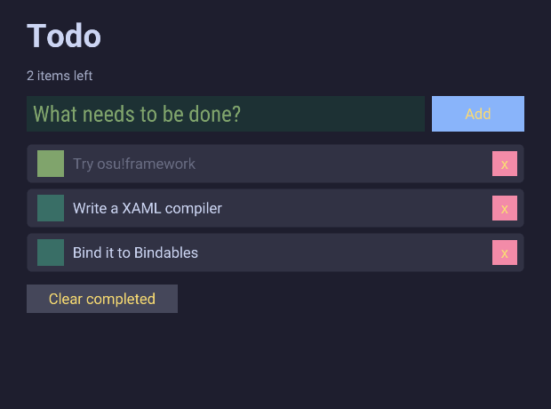
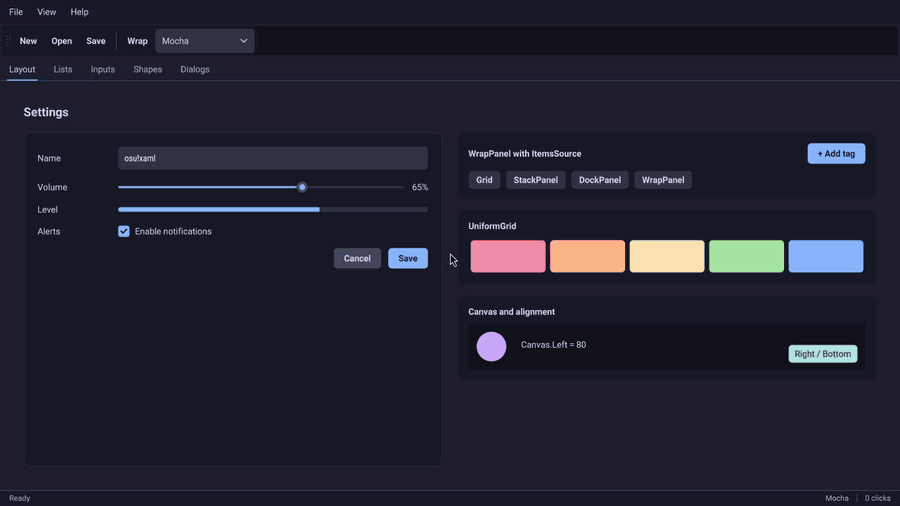

# OsuXaml: osu!framework 위의 컴파일형 XAML

osu!framework 타입 이름을 그대로 쓰는 XAML을 빌드 시점에 C#으로 바꾸는 소스 생성기와, 그것으로 만든 할 일(Todo) 앱입니다. 구현 가능성 검증용 프로토타입입니다.



## 구성

| 경로 | 내용 |
| --- | --- |
| `src/OsuXaml.Generator` | Roslyn Incremental Source Generator. `*.xaml`을 읽어 `InitializeComponent()`를 생성 |
| `src/OsuXaml` | 생성된 코드가 호출하는 런타임 (`XamlBinding`, `BindingScope`). 리플렉션 없음 |
| `src/OsuXaml/Controls` | WPF식 컨트롤 (패널, 목록, 메뉴, 탭, 입력, 날짜 등. 아래 [목록](#wpf식-컨트롤)) |
| `samples/TodoApp` | XAML 한 파일 + 뷰모델로 만든 할 일 앱 (osu!framework 기본 컨트롤 사용) |
| `samples/Gallery` | WPF식 컨트롤 갤러리 (메뉴·도구 모음·상태 표시줄이 있는 Window와 Layout, Lists, Inputs, Shapes, Dialogs 탭) |
| `tests/OsuXaml.Tests` | 생성기, 레이아웃 기하, 헤드리스 컨트롤과 갤러리 테스트 404개 |

## 실행

```bash
dotnet run --project samples/TodoApp     # 할 일 앱 (.NET 10 SDK)
dotnet run --project samples/Gallery     # WPF식 컨트롤 갤러리
dotnet test tests/OsuXaml.Tests           # 테스트
```

생성된 C#을 보고 싶으면 `dotnet build samples/TodoApp -p:EmitCompilerGeneratedFiles=true` 후 `obj/Debug/net10.0/generated/`를 확인하세요.

## 동작 방식

1. 앱 프로젝트가 `<AdditionalFiles Include="**\*.xaml" />`로 XAML을 생성기에 넘깁니다.
2. 생성기는 요소 이름을 osu!framework 타입으로, 속성을 프로퍼티로 Roslyn 심볼에서 찾습니다. 못 찾으면 XAML 줄 번호를 가리키는 빌드 오류(OX0001~OX0011)를 냅니다.
3. `x:Class`의 partial 클래스에 `InitializeComponent(뷰모델)`과 `x:Name` 필드를 생성합니다. 생성 코드는 사람이 손으로 쓴 osu!framework 코드와 거의 같습니다.
4. `{Bind}`는 경로와 타입을 빌드 시점에 검사한 뒤 Bindable 연결 코드로 바뀝니다. 런타임 비용은 손으로 쓴 `BindValueChanged`와 같습니다.

```csharp
public partial class MainView : CompositeDrawable
{
    [BackgroundDependencyLoader]
    private void load(TodoViewModel viewModel) => InitializeComponent(viewModel);

    private static float DoneToAlpha(bool done) => done ? 0.35f : 1f;
}
```

## 문법

```xml
<CompositeDrawable xmlns="osu-xaml" xmlns:x="osu-xaml:x" xmlns:local="clr-namespace:TodoApp"
                   x:Class="TodoApp.MainView" x:DataType="local:TodoViewModel" RelativeSizeAxes="Both">
  <FillFlowContainer Direction="Vertical" Spacing="0,14" Margin="0,48,0,0" ItemsSource="{Bind Items}">
    <FillFlowContainer.ItemTemplate>
      <Container RelativeSizeAxes="X" Height="44">
        <BasicCheckbox Current="{Bind Done}" />
        <SpriteText Text="{Bind Text}" Alpha="{Bind Done, Converter=DoneToAlpha, Animate=250}" />
        <BasicButton Text="x" Action="{Bind RemoveItem, Source=Root}" />
      </Container>
    </FillFlowContainer.ItemTemplate>
  </FillFlowContainer>
</CompositeDrawable>
```

| 기능 | 표기 | 생성되는 코드 |
| --- | --- | --- |
| 요소 | osu!framework 타입 이름 (`FillFlowContainer`, `BasicButton`) 또는 `local:MyDrawable` | `new T()` 후 `Add` / 루트는 `AddInternal` |
| 리터럴 | `Anchor="Centre"`, `RelativeSizeAxes="X\|Y"`, `Size="28"`, `Spacing="0,14"`, `Margin="l,t,r,b"`, `Colour="#1e1e2e"` 또는 `White`, `Font="Bold,44"` | enum, `Vector2`, `MarginPadding`, `Colour4.FromHex`, `FrameworkFont.Regular.With(...)` |
| 텍스트 내용 | `<SpriteText>Hello</SpriteText>` | `Text = "Hello"` |
| 단방향 바인딩 | `Text="{Bind Title}"` | 바운드 카피 + `BindValueChanged` |
| 양방향 바인딩 | `Current="{Bind NewText}"` (대상이 `Bindable<T>`) | `target.Current.BindTo(source)` |
| 변환 | `Converter=Method` (x:Class) 또는 `Converter=local:Type.Method`, `StringFormat='{0} items left'` | 메서드 호출 / `string.Format` |
| 애니메이션 바인딩 | `Animate=250, Easing=OutQuint` | 첫 값은 즉시, 이후 변경은 `TransformTo` |
| 이벤트 / 액션 | `Action="{Bind AddItem}"`, `OnCommit="{Bind AddItem}"`, `Action="OnClick"` (코드비하인드) | 람다 |
| 리스트 | `ItemsSource="{Bind Items}"` + `<X.ItemTemplate>` | `BindableList` 변경을 행 단위로 추가/삭제 |
| 템플릿에서 루트 접근 | `{Bind RemoveItem, Source=Root}` | 한 개짜리 인자에는 현재 아이템을 넘김 |
| 이름 | `x:Name="input"` | `private BasicTextBox input;` |
| 다른 요소에 바인딩 | `Text="{Bind Value, ElementName=volume}"` | 모든 요소가 만들어진 뒤 연결 |
| 정적 값 / null | `Foreground="{x:Static local:Palette.Pink}"`, `Content="{x:Null}"` | 필드·프로퍼티 참조 / `null` |
| WPF 표기 | `{Binding Title}`은 `{Bind Title}`과 같습니다 | |

## 템플릿, 리소스, 스타일

전부 빌드 시점에 풀립니다. 리소스 키나 스타일 대상이 틀리면 XAML 줄 번호가 붙은 빌드 오류(OX0012 등)가 나고, 런타임에는 사전 조회가 없습니다.

```xml
<Window x:Class="Demo.MainWindow" x:DataType="local:PeopleViewModel" Title="People">
  <Window.Resources>
    <Colour4 x:Key="Warm">#fab387</Colour4>
    <Style TargetType="Button">                       <!-- 키 없는 스타일: 범위 안의 모든 Button -->
      <Setter Property="CornerRadius" Value="12" />
    </Style>
    <Style x:Key="Danger" TargetType="Button">
      <Setter Property="Background" Value="{StaticResource Warm}" />
    </Style>
    <DataTemplate x:Key="PersonCard" x:DataType="local:Person">
      <StackPanel Orientation="Horizontal" Spacing="8">
        <TextBlock Text="{Bind Name}" />
        <TextBlock Text="{Bind Age, StringFormat='({0})'}" Foreground="{StaticResource Warm}" />
      </StackPanel>
    </DataTemplate>
  </Window.Resources>

  <ListBox ItemsSource="{Bind People}" SelectedItem="{Bind Selected}" ItemTemplate="{StaticResource PersonCard}" />
</Window>
```

| 기능 | 표기 | 동작 |
| --- | --- | --- |
| 데이터 템플릿 | `<ListBox.ItemTemplate><DataTemplate>...` | 아이템 타입은 `ItemsSource`에서 추론합니다 (`BindableList<Person>`이면 `Person`). `x:DataType`으로 지정할 수도 있습니다 |
| 텍스트 템플릿 | `DisplayMemberPath="Name"`, `DisplayMemberBinding="{Bind Name}"` | 그 멤버를 보여주는 `TextBlock` 템플릿으로 컴파일 |
| 콘텐츠 템플릿 | `Content="{Bind Selected}"` + `<ContentControl.ContentTemplate>` | `XTemplate`의 아이템 타입은 같은 요소의 `X` 바인딩 타입에서 추론 |
| 계층 템플릿 | `<HierarchicalDataTemplate ItemsSource="{Bind Children}">` | 각 아이템의 자식 목록을 바운드 카피로 넘김 (TreeView용) |
| 컨트롤 템플릿 | `<Button.Template><ControlTemplate TargetType="Button">` + `{TemplateBinding Background}` + `<ContentPresenter />` | 컨트롤의 기본 모양을 통째로 교체 |
| 아이템 바인딩 | `Binding="{Bind Done}"` (DataGrid 열 등) | `ItemBinding<Todo, bool>` 접근자로 컴파일. 리플렉션 없음 |
| 리소스 | `<X.Resources>`의 `x:Key` 항목, `{StaticResource Key}` | 텍스트 리소스는 대상 타입의 리터럴로, 템플릿은 그 자리에서 컴파일, 다른 요소는 쓸 때마다 새로 생성 |
| 공용 리소스 | 루트가 `<ResourceDictionary>`인 `.xaml` 파일 | 모든 페이지에서 보입니다 (WPF의 App.xaml 리소스 역할) |
| 스타일 | `<Style TargetType="Button">`, `Style="{StaticResource Key}"`, `BasedOn`, `EventSetter` | 세터를 요소 생성 코드에 인라인. 요소에 직접 쓴 값이 이깁니다 |
| 암시적 템플릿 | `<DataTemplate DataType="{x:Type local:Person}">` (키 없음) | 같은 아이템 타입의 ItemsControl에 자동 적용 |
| 컬렉션 | `<local:Bag.Tags><x:String>a</x:String></local:Bag.Tags>`, `<ItemsPanelTemplate>` | 기존 컬렉션에 `Add`, 래퍼는 생략 가능 |
| 기본 변환기 | `Converter=Not`, `BoolToVisibility`, `InverseBoolToVisibility`, `IsNull`, `IsNotNull`, `NullToVisibility` 등 | x:Class에 같은 이름이 없으면 `OsuXaml.Converters`에서 찾음 |
| 전역 속성 | `Visibility="Collapsed"`, `HorizontalAlignment`, `ToolTip`, `ContextMenu` | `[assembly: XamlGlobalProperties(typeof(T))]`로 등록한 정적 `SetX(Drawable, 값)` |

선택 상태(`SelectedItem`, `IsChecked`, `IsExpanded`, `IsOpen` 등)는 `Bindable<T>` 프로퍼티라서 뷰모델의 `Bindable<T>`와 양방향으로 연결됩니다. `SelectedItem`은 `Bindable<object>`지만 뷰모델의 `Bindable<Person>`과도 바로 묶입니다.

## WPF식 컨트롤



`xmlns="osu-xaml"` 기본 네임스페이스에서 `OsuXaml.Controls`를 osu!framework보다 먼저 찾습니다. 그래서 `Button`, `TextBox`는 WPF식 컨트롤이 되고, osu!framework 컨트롤은 `BasicButton`처럼 원래 이름으로 계속 쓸 수 있습니다.

```xml
<DockPanel RelativeSizeAxes="Both">
  <Border DockPanel.Dock="Top" Background="#181825" Padding="20,14">
    <TextBlock Text="{Bind Greeting}" FontSize="26" FontWeight="Bold" />
  </Border>
  <Grid Padding="24" ColumnDefinitions="110,*,Auto" RowDefinitions="Auto,Auto,*" ColumnSpacing="12" RowSpacing="16">
    <TextBlock Text="Volume" VerticalAlignment="Center" />
    <Slider Grid.Column="1" Value="{Bind Volume}" />
    <TextBlock Grid.Column="2" Text="{Bind Volume, StringFormat='{0:0}%'}" />
    <StackPanel Grid.Row="1" Grid.ColumnSpan="3" Orientation="Horizontal" Spacing="10" HorizontalAlignment="Right">
      <Button Content="Cancel" />
      <Button Content="Save" Click="{Bind Save}" />
    </StackPanel>
  </Grid>
</DockPanel>
```

| 분류 | 컨트롤 | 주요 속성 |
| --- | --- | --- |
| 패널 | `Grid` | `RowDefinitions`/`ColumnDefinitions` (`"Auto,120,*,2*"` 또는 `<RowDefinition Height="Auto" MinHeight="40" />`), `RowSpacing`, `ColumnSpacing`, 첨부 `Grid.Row/Column/RowSpan/ColumnSpan` |
| | `GridSplitter` | 자기 열(행)에 두고 끌어서 옆 열 크기 조절, `ResizeDirection`, `ResizeBehavior`, `ShowsPreview`, 키보드 |
| | `StackPanel`, `WrapPanel` | `Orientation`, `Spacing` |
| | `DockPanel` | `LastChildFill`, 첨부 `DockPanel.Dock` |
| | `Canvas` | 첨부 `Canvas.Left/Top/Right/Bottom` |
| | `UniformGrid` | `Rows`, `Columns` |
| 루트·콘텐츠 | `Window`, `UserControl` | XAML 파일의 루트. `Window`는 `Title`과 팝업 레이어를 가집니다 |
| | `Border`, `ContentControl`, `ContentPresenter` | `Background`, `BorderBrush`, `BorderThickness`, `CornerRadius`, `Padding`, `Content` + `ContentTemplate`, `Template` |
| | `Page`, `Frame` | `<Page x:Class="App.HomePage" Title="Home">` 루트, `Frame.Navigate(page)`, `GoBack()`/`GoForward()`, `CanGoBack`/`CanGoForward` (바인딩 가능), `NavigationService`, 뒤로 가기 기록 유지, 슬라이드 전환, `NavigationUIVisibility` |
| | `Dialog` | `<Dialog x:Class="App.SettingsDialog" Title="Settings">` 루트, `await dialog.ShowDialog(this)`, `DialogResult`, `Closing`, 버튼의 `IsDefault`/`IsCancel` (Enter/Escape) |
| | `ScrollViewer` | `VerticalScrollBarVisibility`/`HorizontalScrollBarVisibility` (`Auto`, `Visible`, `Hidden`, `Disabled`), `ScrollToEnd()`, `VerticalOffset` |
| 텍스트 | `TextBlock` | `Text` (`\n`에서 줄바꿈), `FontSize`, `FontWeight`, `FontStyle`, `TextDecorations`, `Foreground`, `TextWrapping`, `TextTrimming`, 인라인 |
| | `Run`, `Span`, `Bold`, `Italic`, `Underline`, `LineBreak` | `TextBlock` 안의 인라인. `Text`, `FontSize`, `FontWeight`, `FontStyle`, `TextDecorations`, `Foreground` |
| | `Label` | `Content="_Name"` (Alt+N 접근 키), `Target="{Binding ElementName=box}"` |
| | `Hyperlink` | `NavigateUri`, `Click`, `RequestNavigate` |
| | `TextBox` | `Text` (양방향), `PlaceholderText`, `MaxLength`, `IsReadOnly`, `TextChanged`, `AcceptsReturn`, `TextWrapping`, `MinLines`/`MaxLines` |
| | `PasswordBox` | `Password` (양방향), `PasswordChar`, `PasswordChanged` |
| 버튼 | `Button` | `Content` 또는 자식 요소, `Click`, `IsEnabled`, 호버/누름 애니메이션 |
| | `RepeatButton` | 누르고 있으면 `Delay` 뒤 `Interval`마다 `Click` |
| | `ToggleButton` | `IsChecked` (양방향), `Checked`/`Unchecked` |
| | `CheckBox` | `IsChecked` (양방향), `Content`, Space로 전환 |
| | `RadioButton` | `IsChecked` (양방향), `GroupName` (없으면 같은 부모끼리 한 그룹) |
| 범위 | `Slider` | `Value` (양방향), `Minimum`, `Maximum`, `Orientation`, `TickFrequency`, `TickPlacement`, `IsSnapToTickEnabled`, 키보드 |
| | `ProgressBar` | `Value`, `Minimum`, `Maximum`, `IsIndeterminate`, `Orientation` |
| | `ScrollBar`, `Thumb` | `Value` (양방향), `ViewportSize`, `SmallChange`/`LargeChange`, `Scroll`; `Thumb`의 `DragStarted`/`DragDelta`/`DragCompleted` |
| 목록 | `ItemsControl` | `ItemsSource`, `ItemTemplate`, `DisplayMemberPath`, `ItemsPanel` (`VirtualizingStackPanel`이면 가상화) |
| | `ListBox` | `SelectedItem`/`SelectedIndex` (양방향), `SelectionMode`, `SelectedItems`, 키보드, `ScrollIntoView`, 가상화 |
| | `ListView` + `GridView` | `GridViewColumn` (`Header`, `DisplayMemberBinding`, `CellTemplate`, `Width`, `SortMemberPath`), 머리글 클릭 정렬, 경계 드래그로 열 너비 조절 |
| | `DataGrid` | `DataGridTextColumn`/`DataGridCheckBoxColumn`/`DataGridTemplateColumn`, 더블클릭·F2 편집, `AlternatingRowBackground`, `IsReadOnly`, 정렬 |
| | `TreeView` | `HierarchicalDataTemplate`, `TreeViewItem`, `SelectedItem` (양방향), `IsExpandedBinding`, 키보드, 가상화 (`IsVirtualizing="True"`일 때) |
| | `ComboBox` | `SelectedItem`/`SelectedIndex`/`SelectedValue` (양방향), `IsDropDownOpen`, `IsEditable` + `Text`, `PlaceholderText`, 키보드 |
| 메뉴·팝업 | `Menu`, `MenuItem` | `Header="_File"`, `Click`, `InputGestureText`, `IsCheckable`/`IsChecked`, 하위 메뉴, Alt 접근 키 |
| | `ContextMenu` | 모든 요소에 `<Border.ContextMenu>`로 붙이고 오른쪽 클릭으로 엽니다 |
| | `ToolTip` | 모든 요소에 `ToolTip="..."` 또는 `<Button.ToolTip><ToolTip>...` |
| | `Popup` | `IsOpen` (양방향), `PlacementTarget`, `Placement`, `StaysOpen` |
| | `MessageBox` | `await MessageBox.Show(this, "Delete?", "Confirm", MessageBoxButton.YesNo, MessageBoxImage.Warning)` → `MessageBoxResult` |
| 구획 | `TabControl`, `TabItem` | `SelectedIndex`/`SelectedItem` (양방향), `TabStripPlacement`, `ItemsSource` + `ContentTemplate` |
| | `Expander` | `Header`, `IsExpanded` (양방향), 높이 애니메이션 |
| | `GroupBox`, `HeaderedContentControl` | `Header`, `HeaderTemplate` |
| | `StatusBar`, `StatusBarItem` | `DockPanel.Dock="Right"`로 오른쪽 정렬, 세로 `Separator` |
| | `ToolBar`, `ToolBarTray` | 평평한 버튼·토글·콤보, `Band`/`BandIndex` |
| | `Separator` | 가로 구분선 (메뉴, 상태 표시줄, 도구 모음 안에서는 맞는 모양으로) |
| 날짜·색 | `Calendar` | `SelectedDate` (양방향), `DisplayDate`, `FirstDayOfWeek`, 월·연·10년 보기, 키보드 |
| | `DatePicker` | `SelectedDate` (양방향), `SelectedDateFormat`, 직접 입력, F4·Alt+↓로 열기 |
| | `ColorPicker` | `SelectedColor` (양방향) |
| 도형·이미지 | `Rectangle`, `Ellipse` | `Fill`, `Stroke`, `StrokeThickness`, `RadiusX`/`RadiusY`, `Stretch` |
| | `Line`, `Polyline`, `Polygon` | `X1`/`Y1`/`X2`/`Y2`, `Points="0,0 10,20 20,0"`, `Fill` (Polygon) |
| | `Path` | `Data="M 0,0 L 10,10 C ... Z"` (WPF 경로 문법), `<Geometry x:Key>` 리소스, `Stretch="Uniform"` |
| | `Image` | `Source` (파일 경로 또는 osu! 텍스처 이름), `Stretch`, `StretchDirection`, `ImageFailed` |
| | `Viewbox` | 자식 하나를 비율 유지하며 늘이거나 줄임, `Stretch`, `StretchDirection` |
| | `Icon` | `Kind="Solid.Check"` (osu!framework의 FontAwesome), `Size`, `Foreground` |
| 공통 | 모든 요소 | `HorizontalAlignment`, `VerticalAlignment` (`Stretch` 기본), `Margin`, `Width`/`Height`, `Visibility`, `ToolTip`, `ContextMenu` |

패널과 `ItemsSource`도 함께 쓸 수 있습니다 (`<WrapPanel ItemsSource="{Bind Tags}">`). `{Bind}`처럼 경로를 비우면 아이템 자체에 바인딩됩니다.

### 대화상자와 페이지 이동

WPF의 `MessageBox.Show`와 `ShowDialog()`는 결과가 나올 때까지 호출한 스레드를 막지만, osu!framework의 Update 스레드는 막을 수 없습니다. 그래서 같은 이름의 메서드가 `Task`를 돌려주고, 코드비하인드에서는 `await`로 씁니다. 대화상자는 창 전체를 어둡게 덮고 아래 입력을 막는 모달로 열립니다.

```csharp
private async void OnDelete()
{
    if (await MessageBox.Show(this, "Delete 3 files?", "Confirm", MessageBoxButton.YesNo, MessageBoxImage.Warning) == MessageBoxResult.Yes)
        viewModel.DeleteSelected();
}

private async void OnSettings()
{
    bool? saved = await new SettingsDialog().ShowDialog(this);   // SettingsDialog.xaml의 루트는 <Dialog>
}
```

`Frame`은 WPF처럼 `Page` 인스턴스를 보여주고, 뒤로 간 페이지는 버리지 않고 기록에 남겨 같은 상태로 돌아옵니다. 페이지 안에서는 `NavigationService.Navigate(new DetailsPage())`로 이동합니다.

### 여러 줄 텍스트

`TextBlock`은 `Text` 안의 `\n`(XAML 속성에서는 `&#10;`)과 `<LineBreak />`에서 줄을 바꾸고, 내용에 인라인을 섞어 쓸 수 있습니다. 생성기는 WPF와 같은 공백 규칙을 따릅니다. 이어진 공백과 줄바꿈은 공백 하나가 되고, 태그 바로 안쪽과 `LineBreak` 앞뒤의 공백은 지워집니다. `xml:space="preserve"`를 붙이면 그대로 둡니다.

```xml
<TextBlock TextWrapping="Wrap">
  Text mixes <Bold>bold</Bold>, <Italic>italic</Italic> and <Run Foreground="#f9e2af">coloured</Run> runs,
  <LineBreak />
  and <Run Text="{Bind Name}" FontWeight="Bold" /> breaks onto a new line.
</TextBlock>

<TextBox Text="{Bind Notes}" AcceptsReturn="True" TextWrapping="Wrap" MinLines="3" MaxLines="6" />
```

- 각 줄은 그 줄에서 가장 큰 글꼴만큼 높아지고, `TextTrimming`은 줄마다 따로 말줄임표를 붙입니다.
- `Text`는 인라인의 글자를 이어 붙인 값입니다. `Text`를 직접 바꾸면 인라인 대신 그 글자가 나옵니다.
- `AcceptsReturn="True"`인 `TextBox`는 Enter로 줄을 바꾸고 붙여 넣은 줄바꿈도 남깁니다. `Text`에는 `\n`으로 들어가고, 뷰모델이 넣은 `\r\n`도 `\n`으로 맞춥니다.
- `Height`가 없으면 `AcceptsReturn`이나 `TextWrapping`을 켠 상자는 줄 수만큼 자라고, `MinLines`/`MaxLines`가 그 범위를 정합니다. `Height`를 주면 그 높이 안에서 캐럿을 따라가고 마우스 휠로도 스크롤합니다.
- 위·아래 화살표는 열 위치를 기억하며 줄을 옮깁니다. PageUp/PageDown, 줄 단위 Home/End, Ctrl+Home/End, 세 번 클릭(줄 선택)도 WPF처럼 동작합니다.

### 가상화

`ListBox`, `ListView`, `DataGrid`의 기본 `ItemsPanel`은 WPF처럼 `VirtualizingStackPanel`입니다. 화면에 보이는 행과 위아래 여유분에만 컨테이너를 만들고 스크롤해서 벗어난 행은 버리므로, 10만 행이어도 드는 비용은 화면에 보이는 행만큼입니다.

```xml
<ListBox ItemsSource="{Bind People}" VirtualizingPanel.VirtualizationMode="Recycling" />
<DataGrid ItemsSource="{Bind Rows}" VirtualizingPanel.IsVirtualizing="False" />
<TreeView ItemsSource="{Bind Roots}" VirtualizingPanel.IsVirtualizing="True" />
<ItemsControl ItemsSource="{Bind Tags}">
  <ItemsControl.ItemsPanel><VirtualizingStackPanel /></ItemsControl.ItemsPanel>
</ItemsControl>
```

- `VirtualizationMode="Recycling"`은 벗어난 행의 컨테이너를 버리지 않고 새로 보이는 행에 다시 씁니다. `IsVirtualizing="False"`는 예전처럼 모든 행을 미리 만듭니다. WPF처럼 `VirtualizingStackPanel.IsVirtualizing`이라고 써도 됩니다.
- `TreeView`는 WPF처럼 `IsVirtualizing="True"`를 줄 때만 가상화합니다. 그러면 펼친 단계마다 보이는 노드만 만들고, 선택된 노드와 그 조상은 화면 밖에서도 남습니다. 스크롤해서 사라졌다 돌아온 노드는 펼침 상태를 그대로 가지고 (`IsExpandedBinding`이 있으면 뷰모델에서, 없으면 아이템별로 기억합니다), `ExpandSubtree()`는 하위 노드를 화면에 나타날 때 펼칩니다.
- `TreeView.ScrollIntoView`는 아직 만들어지지 않은 중첩 노드도 찾습니다. 아이템과 그 자식을 `HierarchicalDataTemplate`으로 따라가며 깊이 우선으로 찾은 뒤, 조상을 펼치고 그 경로의 노드를 만들어 스크롤합니다. 가상화 여부와 상관없이 동작합니다 (WPF는 이미 만들어진 노드만 찾습니다).
- 한 번 보인 행은 잰 높이를, 아직 안 보인 행은 그 평균을 씁니다 (트리 노드는 펼쳐져 있어도 머리글 높이로 셉니다). 행 높이가 같으면 스크롤 범위가 정확하고, 다르면 스크롤하면서 맞춰집니다. 위쪽 추정치가 고쳐질 때는 스크롤 위치를 같이 옮겨서 보고 있는 행이 움직이지 않습니다.
- 선택, `ScrollIntoView`, 키보드 이동(Home/End 포함)은 컨테이너가 없는 행에도 동작합니다. 편집 중이거나 포커스를 가진 행은 화면 밖으로 나가도 남습니다.
- `ContainerFromIndex`/`ContainerFromItem`은 컨테이너가 없는 행에 `null`을 돌려줍니다. `ListView`와 `DataGrid`의 `Auto` 열은 지금까지 보인 셀 중 가장 넓은 폭을 유지합니다.

### 레이아웃 동작

- 매 프레임 자식 업데이트가 끝난 뒤(`UpdateAfterChildren`) 패널이 자식을 측정(Measure)하고 배치(Arrange)합니다. 이 시점에는 자동 크기 자식의 크기가 이미 확정되어 있습니다.
- 자식마다 `Slot`이 하나씩 붙어서 정렬과 여백을 처리합니다. 기본값은 WPF처럼 `Stretch`이고, 크기를 명시한 자식은 가운데에, 텍스트처럼 내용 크기인 자식은 시작 위치에 놓입니다.
- 다른 패널 안에 있지 않고 크기도 없는 패널은 내용 크기에 맞춰 스스로 크기를 정합니다.
- 첨부 속성은 생성기가 `Grid.SetRow(element, 1)` 같은 정적 메서드 호출로 바꿉니다. `Set이름(Drawable, 값)` 형태의 정적 메서드만 있으면 직접 만든 첨부 속성도 똑같이 동작합니다.
- `RowDefinitions` 문법 오류는 빌드 오류로 나옵니다. 정적 `Parse(string)` 메서드가 있는 타입은 모두 문자열로 쓸 수 있습니다.

## 수명 관리

뷰모델은 바운드 카피를 약한 참조로만 들고 있으므로, 생성된 코드는 카피를 `BindingScope` 필드에 모읍니다. osu!framework는 Drawable을 해제할 때 `IUnbindable` 필드를 모두 해제하므로, 뷰가 사라지면 바인딩도 자동으로 끊깁니다. 리스트의 각 행은 자기 스코프를 가지며, 행이 삭제될 때 함께 끊깁니다. (이 구조는 헤드리스 테스트가 뷰 교체 시 해제된 컨테이너를 건드리는 버그를 잡아내서 도입했습니다.)

## 아직 없는 것

- 핫 리로드 연결 (`HotReloadCallbackReceiver`로 뷰 재생성), IDE 자동완성 스키마, 제네릭 타입 요소
- 여러 줄 `TextBox`에는 스크롤바가 없습니다 (캐럿과 마우스 휠로만 스크롤). `TextBlock`의 `TextAlignment`, 글꼴 패밀리 지정, 인라인 `Hyperlink`/`InlineUIContainer`도 없습니다
- `DataGrid`의 `AutoGenerateColumns` (리플렉션을 쓰지 않으므로 열을 직접 적어야 합니다), `CheckBox`의 `IsThreeState`, `Calendar`의 여러 날짜 선택, `TabControl` 탭이 넘칠 때의 스크롤
- 도형은 단색 `Fill`/`Stroke`만 받습니다 (그라데이션 브러시 없음). 선 끝과 이음은 항상 둥글고, 점선과 `FillRule`은 없습니다
- 마우스 커서 모양을 바꾸지 못해서 `GridSplitter`, `Hyperlink` 같은 곳은 색으로만 반응합니다
- `Icon Kind`의 오타는 빌드 오류가 아니라 실행 중 물음표 아이콘으로 나타납니다
- 모달은 `Window`(팝업 레이어) 단위입니다. 한 게임에 Window가 여럿이면 각자 따로 막힙니다
- 여러 칸에 걸친 Grid 자식은 Auto 크기 계산에 들어가지 않습니다 (WPF는 반영합니다)
- 패널은 매 프레임 측정합니다. 프레임당 캐시는 있지만 무효화 기반 최적화는 아직 없습니다
- 백그라운드 스레드에서 뷰모델을 바꿀 때의 Update 스레드 마샬링
- 한글 글꼴: osu!framework 기본 Roboto에는 한글이 없어 샘플은 영어 UI입니다
